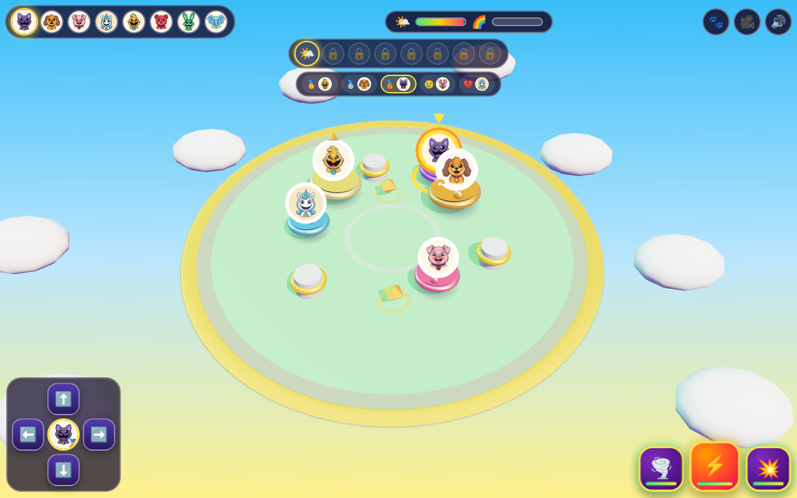

# Critter Sumo Bumpers 3D: Sky Ring Knockout!

**Play Live:** [https://kunruiw1991.github.io/critters-sumo3d/](https://kunruiw1991.github.io/critters-sumo3d/)

## Overview
**Critter Sumo Bumpers 3D: Sky Ring Knockout!** is a kid-friendly 3D WebGL arena bumper brawler built with **Three.js (r128)** where all 8 Smiling Critters clash in inflatable belly-bumper sumo tubes across 8 themed floating sky-islands! Knock opponents off the ring, dodge environmental hazards, grab Mega-Belly and Magnet-Shield power-ups, and finish in the **Top 3 (1st, 2nd, or 3rd Place)** to qualify for the next stage!

## 3D Engine & Gameplay Highlights
- **Custom 3D Chibi Sumo Critter Rig**: Articulated procedural Three.js models for all 8 Smiling Critters (**CatNap**, **DogDay**, **Bobby BearHug**, **PickyPiggy**, **Hoppy Hopscotch**, **Bubba Bubbaphant**, **CraftyCorn**, **KickinChicken**) featuring custom ears/horns/crests/trunks, textured portrait badges, signature pendants, waddling feet, and glossy inner-tube sumo rings with 8 gold stud rivets.
- **Tactile Impulse & Belly-Slam Physics**: Responsive WASD / Arrow Keys / Virtual Joystick movement, **SPACE / Z** dash with 3-tier Charge Surge (`1.0x`, `1.22x`, `1.45x` impulse), and **SHIFT / X** Ground-Pound Shockwave AoE blast with golden expanding shockwave rings.
- **Last-Chance Ledge Recovery**: Getting knocked past the ring edge triggers an interactive **MASH SPACE!** recovery window (`1.5s`) with a pulsing cyan tether beam and upward launch back onto the stage.
- **Fair Top-3 Qualification Rules**: Finishing in **1st, 2nd, or 3rd place** advances you to the next stage with a celebratory 3-pillar 3D Podium Ceremony (`1ST`, `2ND`, `3RD`) and confetti!
- **Accessibility & Kids Comfort**: Full English & Español localization, **ZEN / RELAX** mode (infinite ledge recovery & gentler knockback), and **1P vs 2P Local Co-Op** support.

## 8 Sky-Ring Stages
1. **Stage 1 — Sunny Dojo**: Classic wooden dohyo sky ring with sacred shimenawa rope border.
2. **Stage 2 — Frostbite Glacier**: Low-friction ice sheet with 2 sweeping ice-spinner beams.
3. **Stage 3 — Crumble Canyon**: Outer stone ring segments shake and collapse mid-match, shrinking the safe arena.
4. **Stage 4 — Pinball Bumper Dome**: 3 high-restitution neon pinball mushrooms in the inner ring for chaotic ricochets.
5. **Stage 5 — Tilt-A-Whirl Sky Raft**: Floating sky-raft that dynamically tilts and rolls under uneven weight distribution.
6. **Stage 6 — Conveyor Factory**: Rotating boost pads that launch critters toward the center or perilous edges.
7. **Stage 7 — Magma Geyser Crater**: Periodic glowing warning rings that erupt into vertical lava geysers.
8. **Stage 8 — Starlight Grand Finals**: Cosmic championship ring combining rotating pinball bumpers, shrinking outer tiles, and meteor shockwaves!

## 10-Round Creator + Critic Iterative Refinement Changelog
- **Round 1**: Built complete Three.js 3D arena engine, 8 Smiling Critters character models, 8 stages, WebAudio synthesizer, EN/ES localization, and Top-3 qualification flow.
- **Round 2**: Added interactive 3D Title Showroom diorama with auto-orbiting camera and animated exhibition sumo bouts behind the translucent title card.
- **Round 3**: Upgraded 3D critter models with signature chest pendant charms, dynamic facial expressions (determined, shocked, dizzy), and 8 golden tube rivets.
- **Round 4**: Implemented directional danger boundary chevrons, pulsing red rim vignette when near the edge, and tactile hit-stop + camera shake on heavy collisions.
- **Round 5**: Added stage-specific 3D hazard warning telegraphs (glowing floor rings before geyser eruptions, shaking cracks before tile collapse, and pinball bumper shock-rings).
- **Round 6**: Enhanced 3-tier Belly-Charge visual aura (cyan/gold/magenta particle ring around the sumo tube) and directional launch arrow decal on the arena floor.
- **Round 7**: Added off-screen/edge survivor pointers, floating comic impact callouts (`WHAM!`, `MEGA BUMP!`, `SAVED!`), and KO Ring-Out splash beams.
- **Round 8**: Built the 3D Top-3 Podium Ceremony showcase at stage end with Gold/Silver/Bronze pillars, jumping medalists, and celebratory confetti bursts.
- **Round 9**: Refined AI steering intelligence (hazard avoidance, center-seeking recovery, smart charge targeting) and balanced Zen Mode forgiveness for younger players.
- **Round 10**: Final visual polish, HUD responsiveness, audio-visual synchronization, and headless WebGL verification.
